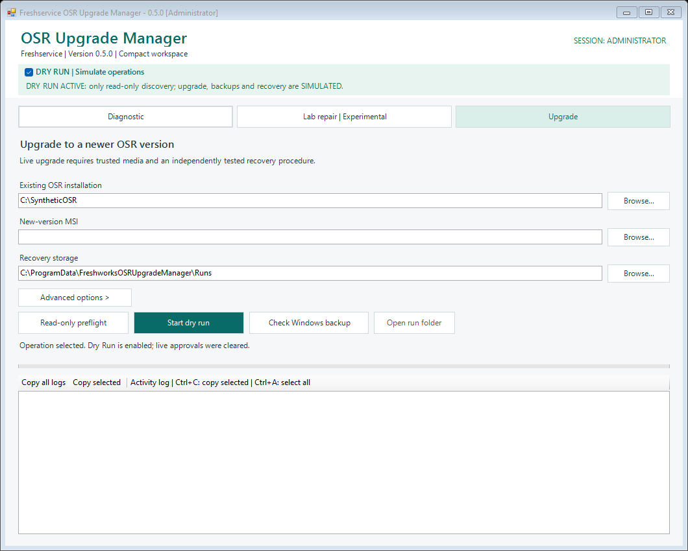
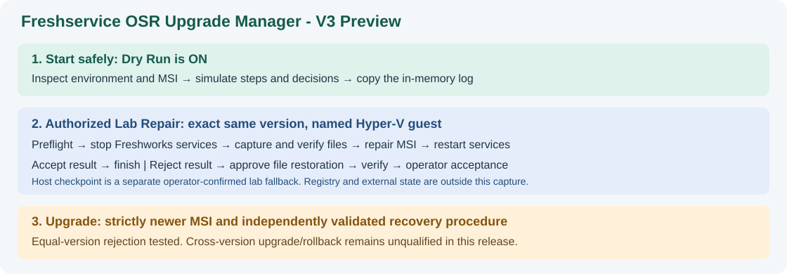

# Freshservice OSR Upgrade Manager

**0.5.1 — Release 3.** Adds controlled replacement for the inspected 2.4 -> 2.5 media pair, verified application-file recovery, a short default backup path and encrypted path preferences. One integrated replacement-and-rollback trial completed in the dedicated VM, with the lab entry ONLINE after both stages. The same Web Request scenario returned HTTP 200 after replacement in 2.5 and after rollback to 2.4. The separate Microsoft Active Directory - Orch application's actions were outside this test; the demonstrated scope is the exercised OSR Web Request scenario. See [final publication scope and evidence](docs/RELEASE_0_5_1_FINAL.md). The original preview tag and assets are retained unchanged. [Download the EXE, source ZIP and checksums](https://github.com/Joystrife/freshservice-osr-upgrade-manager/releases/tag/v0.5.1-preview.3). The 0.5.0 information below is historical.


**Environment-aware deployment and recovery management for the Freshworks Freshservice Orchestration Server.**

[](https://github.com/Joystrife/freshservice-osr-upgrade-manager/actions/workflows/powershell-syntax.yml)

**0.5.0 — Compact Workspace and portable executable, experimental prerelease.** This is a community project, not an official Freshworks application. The GUI runs on Windows PowerShell 5.1 and Windows Forms. The integrated same-version repair and installation-file restoration paths have been exercised in a dedicated Windows Server 2019 lab. **Cross-version upgrades, downgrades and full application recovery are not validated.**

Download the portable EXE or complete source ZIP from [GitHub Releases](https://github.com/Joystrife/freshservice-osr-upgrade-manager/releases/tag/v0.5.0). Verify the accompanying SHA-256 checksums. Double-click `OSR-Upgrade-Manager-0.5.0-portable.exe` to open Diagnostic with Dry Run enabled. For the source ZIP, extract all files and run **Start-Manager.cmd**. The unsigned EXE requires 64-bit Windows, Windows PowerShell 5.1 and .NET Framework 4.7.2 or later. Freshworks MSI packages are not included.

Start with the [User Guide](docs/USER_GUIDE.md), then review [Known Issues](docs/KNOWN_ISSUES.md), [Release Notes](docs/RELEASE_0_5.md) and [Test Evidence](docs/MANUAL_TEST_RESULTS.md).





| Mode | Purpose | Evidence in 0.5.0 |
| --- | --- | --- |
| Dry Run | Read-only inspection followed by an in-memory UI simulation | Tested; simulation can continue after readiness warnings |
| Upgrade | Deploy a newer authenticated MSI with independent recovery prerequisites | Equal-version rejection tested; cross-version deployment is unqualified |
| Lab Repair | Exercise the main GUI/worker on the exact installed version in a named Hyper-V guest | Accepted same-version repair/restoration trials, including the portable Workspace GUI |

## Vision

The application aims to reduce the number of manual tasks required to maintain a Freshservice Orchestration Server:

**Detect environment → Select official installer → Assess recovery → Create a recoverable point → Deploy → Verify → Accept or Restore**

A future recovery-provider architecture will select capabilities based on **what can actually be created and restored**, not merely which hypervisor or cloud vendor the host reports.

## Current capabilities

| Capability | Status |
| --- | --- |
| English-language Windows Forms GUI | Implemented |
| Default-on, in-memory Dry Run | Implemented |
| Administrator elevation through Windows UAC when entering Live Mode | Implemented; Windows acceptance testing ongoing |
| Installed OSR version and Freshworks service discovery | Implemented |
| Official MSI metadata and signature/checksum validation | Implemented |
| Automatic search for a matching previous original OSR MSI | Implemented (bounded local search; cannot download old versions) |
| Controlled Windows service stop/start | Observed in same-version lab repair/restoration; cross-version deployment unqualified |
| Manual post-installation functional acceptance | Implemented |
| Previous-MSI-based application recovery engine | Implemented but **requires independently validated downgrade procedure** |
| Windows Server Backup (WSB) feature, command and destination candidate discovery | **New in v0.4.0: read-only only** |
| WSB backup command preview with source/target volume validation | **New in v0.4.0: no command execution** |
| Smart Application Backup discovery, protected capture and integrity verification | Future milestone; design only |
| Same-version Lab Repair through the main GUI/worker | Implemented; bounded live lab evidence |
| Installation-file snapshot, hash/permission comparison and operator-approved lab restoration | Implemented for Lab Repair; excludes registry/external state |
| Resizable and copyable in-memory journal | Implemented; Copy all logs, selection, Ctrl+A/Ctrl+C |
| Automatic creation of a Windows Server Backup | Not implemented |
| Full-system recovery automatically executed through WinRE or an external controller | Not implemented |
| AWS / Hyper-V / VMware provider integration | Planned, not implemented |
| First-time OSR installation or relocation | Planned, not implemented |

**A Windows Server Backup command or a hypervisor name is not sufficient evidence that a usable recovery point exists.** The current live-upgrade workflow remains gated by a verified older MSI **and** an independently validated, version-specific application recovery procedure. A WSB capability assessment does not unlock it.

## Quick start: safe Dry Run

Download or clone the repository on a Windows host. Run from the project root:

```powershell
powershell.exe -NoProfile -STA -File ".\src\Freshservice_OSR_Upgrade_GUI.ps1"
```

- **DRY RUN** is checked on startup. The simulated upgrade, backup, service changes and rollback do not modify the server; logs remain in memory.
- **Auto-find** searches for a trustworthy original previous-version MSI without changing software.
- **Check Windows backup** detects Windows Server Backup and candidate backup volumes. This is also read-only.
- If Live Mode is requested, UAC requires a confirmed elevated administrator session. Declining elevation leaves Dry Run enabled.
- Do **not** perform a production upgrade unless its supported recovery procedure has been independently tested and approved.

## Windows Server Backup integration — v0.4.0

`src/OSR.Recovery.WindowsServerBackup.psm1` introduces a Microsoft-native provider:

1. Checks the presence of `wbadmin.exe` and the Windows Server Backup feature when the relevant Windows feature command is available.
2. Detects Windows and OSR installation volumes.
3. Lists other local fixed volumes as **unverified** destination candidates.
4. Builds a non-executing `wbadmin start backup` command preview that includes critical OS volumes and, when separate, the OSR source volume.
5. Rejects targets on source volumes and invalid local/UNC destinations.

This version does **not** create full Windows backups, install Windows features, start or stop backup jobs, or restore a machine. Full-system recovery via `wbadmin start sysrecovery` must run from Windows Recovery Environment. A production-grade remote recovery controller is a separate milestone.

See [Recovery Architecture](docs/RECOVERY_ARCHITECTURE.md) and [Roadmap](ROADMAP.md).

## Future milestone — Smart Application Backup

The next milestone targets OSR application files, configuration, related registry entries, service definitions and permissions. Start with bounded read-only discovery and an in-memory plan, then implement explicitly authorized capture and independent integrity verification. See the [development plan and acceptance criteria](docs/SMART_APPLICATION_BACKUP.md).

Version 0.5.0 delivers Workspace and portable packaging. The complete Smart Application Backup milestone was moved to future work and is not completed by this release. The lab file snapshot is narrower than that planned provider. Dry Run remains enabled by default, Windows PowerShell 5.1 remains the runtime baseline, and a valid backup must not automatically authorize deployment or claim validated cross-version rollback. Full Windows Server Backup creation remains a separate future milestone.

## Source layout

```text
src/
  Freshservice_OSR_Upgrade_GUI.ps1       # Windows Forms GUI and in-memory Dry Run
  OSR.Upgrade.Worker.ps1                 # Controlled upgrade + operator decisions
  OSR.Upgrade.Core.psm1                  # MSI, services, product and local recovery
  OSR.Recovery.WindowsServerBackup.psm1  # Read-only Windows backup provider v0.4
  OSR.Recovery.LabFiles.psm1             # Bounded lab file capture/restore
  OSR.Repair.Lab.ps1                     # Earlier standalone lab experiment
tests/
  Test-RegistryDiscovery.ps1
  Test-WindowsBackupProvider.ps1
  Test-GuiLabMode.ps1
  Test-IntegratedLabWorker.ps1
  Test-LabFiles.ps1
  Test-MsiMetadata.ps1
  Test-SameVersionRepair.ps1
  Test-PortableExecutable.ps1
docs/
  DESIGN.md
  INSTALLATION.md
  RECOVERY_ARCHITECTURE.md
  RECOVERY_PROVIDERS.md
  SMART_APPLICATION_BACKUP.md           # Future scope and acceptance criteria
  USER_GUIDE.md
  KNOWN_ISSUES.md
  RELEASE_V3.md
  RELEASE_0_5.md
  PORTABLE_EXECUTABLE.md
.github/workflows/
  powershell-syntax.yml
ROADMAP.md
CHANGELOG.md
Start-Manager.cmd
LICENSE
```

## Security and responsible operation

An experimental [same-version repair lab](docs/SAME_VERSION_REPAIR_LAB.md) now provides a separate default-read-only entry point. It does not relax production upgrade version checks, implement complete Smart Application Backup, or establish validated restoration.

The main GUI also provides an explicit [integrated Lab Repair workflow](docs/INTEGRATED_LAB_REPAIR.md), using the main worker for backup, repair, acceptance and experimental installation-file restoration. Dry Run remains enabled by default. One live repair/acceptance trial and one live same-version file-restoration trial have been operator-accepted in a dedicated lab; broader recovery and cross-version qualification remain pending. See [Manual Test Results](docs/MANUAL_TEST_RESULTS.md) for evidence and limits.

Never commit MSI installers, recovery-point files, registry exports, service credentials, private keys, backup archives, machine identifiers or execution logs. Preserve restrictive Windows file permissions on backup data. Dry Run does not validate a real upgrade; a successful application MSI install does not prove the orchestration workflows still function.

GitHub Actions executes **Windows PowerShell 5.1 syntax checks and eight regression suites**. Tests use synthetic files/MSI metadata, unshown GUI controls and mocked OSR service/installer boundaries. They create temporary fixtures but never install OSR or control real services. Lab observations and automated checks are described separately in the test evidence.

## Official references

- [Freshworks — Setting up the Orchestration Server](https://support.freshservice.com/support/solutions/articles/50000003259-setting-up-the-orchestration-server)
- [Microsoft — Windows Server Backup command reference](https://learn.microsoft.com/en-us/windows-server/administration/windows-commands/windows-server-backup-command-reference)
- [Microsoft — wbadmin start backup](https://learn.microsoft.com/en-us/windows-server/administration/windows-commands/wbadmin-start-backup)
- [Microsoft — wbadmin start sysrecovery](https://learn.microsoft.com/en-us/windows-server/administration/windows-commands/wbadmin-start-sysrecovery)

## License

The project source is available under the [MIT License](LICENSE). Freshworks installers and third-party products are not included and retain their own terms.
