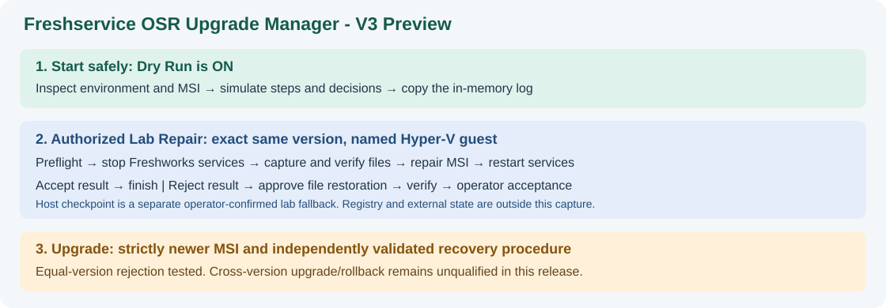

# 0.5.0 User Guide

For the unreleased 0.5.1 preview, first read [Controlled replacement and VM qualification](RELEASE_0_5_1.md). Upgrade now includes a separate inspected 2.4 -> 2.5 replacement strategy with explicit identity-only migration approval. The default recovery root is `%SystemDrive%\OSR\Runs`. Paths and guest name are remembered per Windows user; mode and authorization are reset on normal startup. Earlier instructions below describe the published 0.5.0 behavior unless superseded by the preview notes.

Version 0.5.0 is an experimental source and portable executable release of Freshservice OSR Upgrade Manager. Start with Dry Run. A completed simulation is not proof that a real operation is ready or recoverable.



## 1. Download and start

1. Open the project's GitHub Releases page and download `OSR-Upgrade-Manager-0.5.0-source.zip` or `OSR-Upgrade-Manager-0.5.0-portable.exe`.
2. For the EXE, follow [Portable Executable](PORTABLE_EXECUTABLE.md) and double-click it. For source, extract the entire ZIP into a new local folder. Do not run it inside the archive or mix scripts from different releases.
3. Double-click `Start-Manager.cmd`. Keep the `src` folder beside it.
4. Confirm the window title contains **0.5.0**, **Diagnostic** is selected, and **DRY RUN** is checked. Select **Lab repair** or **Upgrade** to reveal its specific inputs. Expand **Advanced options** for recovery media, hashes and acceptance checks.

The launcher uses the Windows-provided Windows PowerShell 5.1 and Windows Forms, with a process-scoped RemoteSigned policy. It does not install PowerShell or change persistent execution policy. Organization-enforced policy still takes precedence. The portable EXE embeds the same runtime scripts and uses the same PowerShell policy boundary.

For manual startup from the extracted folder:

```powershell
powershell.exe -NoProfile -STA -ExecutionPolicy RemoteSigned -File ".\src\Freshservice_OSR_Upgrade_GUI.ps1"
```

Dry Run does not require an administrator token. Live operations require an elevated Windows session. Use an isolated Windows Server lab for initial real tests; the recorded V3 lab evidence used Windows Server 2019, OSR 2.5.0.0 and its original signed MSI. Download Freshworks installers separately from the official portal. They are not included here.

## 2. Understand the controls

| Control | Meaning |
| --- | --- |
| Operation tabs | **Diagnostic** for read-only inspection; **Upgrade** for a strictly newer MSI; **Lab repair** for the bounded same-version lab test |
| Lab guest computer name | The Windows name inside the guest, not the Hyper-V display name; required for live Lab Repair |
| New FO-OSR.msi | Original Freshworks installer to inspect or use |
| Recovery MSI | Original media matching the installed version for Upgrade; Lab Repair uses the selected same-version MSI |
| Existing installation directory | Must match the path discovered from the Freshworks service executable |
| Recovery storage directory | Protected run files and recovery data; separate from the installation tree |
| Approved SHA-256 | Optional independently verified checksum when vendor-signature validation is unavailable |
| Required functional test | The operator's actual acceptance criterion; Lab Repair defaults to local service/version/configuration checks |
| DRY RUN | In-memory simulation, never a live worker launch |
| Live approval checkboxes | Operation-specific authorization and recovery/checkpoint attestation; not automatic proof of recoverability |
| Open run folder | Opens existing live run artifacts; Dry Run does not create a log folder |

Resize the main window to expand the journal. Use **Copy all logs**, or select lines and use **Copy selected** / Ctrl+C. Ctrl+A selects all lines when the journal has focus. Copy is also available by right-click. Share only reviewed, redacted diagnostics; never post configuration contents or keys.

## 3. First inspection and simulation

1. Keep Dry Run checked. Select an installer if available.
2. Click **Read-only preflight**. Review discovered version, installation path, both Freshworks service states and available original MSI.
3. Click **Start dry run** to walk through simulated capture, service handling, MSI operation and acceptance.
4. Answer Yes to simulate acceptance, or No to simulate a restoration decision. These answers do not execute an orchestration action.

The simulation deliberately continues when inputs or readiness prerequisites are missing, and logs warnings. For example, an installed 2.5 MSI paired with target 2.5 can finish a simulated Upgrade, but the real worker rejects it. `SIMULATED UPGRADE ACCEPTED` must not be read as authorization for a real upgrade.

**Check Windows backup** inspects capabilities only. A missing feature is not an instruction to install it, and a discovered destination or hypervisor does not establish restore readiness.

## 4. Live Lab Repair: same-version maintenance

Prerequisites: a dedicated Hyper-V guest, the exact installed-version original MSI and ProductCode, both Freshworks services running, and an independently confirmed host-side baseline checkpoint. The application does not create, validate or apply that checkpoint. A VM connected to a production tenant is not an isolated test tenant; keep it out of production workflows and do not supply production target credentials.

1. Select **Lab Repair (same version)**. Changing operation rechecks Dry Run and clears live approvals.
2. Inside the intended guest, obtain its Windows name with `$env:COMPUTERNAME` and enter it into **Lab guest computer name**.
3. Select the original MSI. Auto-find in this mode verifies and reuses that same MSI; a different recovery product is not selected.
4. Keep the short default recovery root, typically `C:\OSRLab\Runs`, or choose a separate approved local tree. Review [path limitations](KNOWN_ISSUES.md).
5. Complete read-only inspection first. Then uncheck Dry Run and confirm Live Mode. If needed, approve the Windows UAC prompt; the form settings are transferred to the elevated instance.
6. Confirm the lab authorization and existing baseline checkpoint. This is not a statement that application restoration has already been qualified.
7. Click **Run preflight**. This creates protected diagnostics but does not stop services, capture application files or run MSI. Require `PREFLIGHT_PASSED` before the live test.
8. Click **START LAB REPAIR**, then review and accept its explicit operation confirmation.

The main worker checks identity and paths, stops only the two Freshworks services, captures and verifies installation files and security metadata, saves and verifies original media, repairs the same version using Windows Installer, then attempts to restart services. Native Windows WinRM is not managed. The lab entry can temporarily appear offline. Keep the GUI open and let the worker finish; do not launch a second instance while a real run is active.

At acceptance, independently inspect local service state, unchanged version and expected configuration. Optionally check the dedicated tenant entry's connectivity without running a production workflow. Answer Yes only after those checks. The lab result is `LAB_REPAIR_ACCEPTED`.

## 5. Lab file restoration after rejection

For a supervised restoration trial, use a fresh run and backup. At post-repair acceptance, answer No, then approve the proposed recovery. Do not deliberately damage files for this initial scenario.

The worker revalidates guest/product/path identity, rehashes backup data, restores installation files and permissions, removes post-capture entries only inside the validated tree, compares the restored tree, restarts services and asks for recovery acceptance. Altered backups or unsupported paths block restoration. Confirm the local state before answering the final prompt.

Successful operator acceptance yields `LAB_FILES_RESTORED`. This is installation-file restoration within the active run. It does not restore registry data, external state or credentials, and does not provide recovery after the worker or host has crashed. Retain the independent host checkpoint as the lab fallback.

## 6. Upgrade mode

Upgrade requires a target strictly newer than the installed product, authenticated original recovery media matching the installed version, explicit maintenance approval and an independently tested recovery procedure for the exact version pair. V3 has no validated cross-version production deployment evidence.

The same-version negative test is useful: select the installed-version MSI in Upgrade and run live **Run preflight**. Expect `Upgrade MSI ... is not newer than installed ...`, with no service control or installation. Do not check a validated-recovery checkbox merely to get past a block. A backup command, a VM indicator or a successful Lab Repair is not a substitute for the required recovery evidence.

## 7. Interpret results

| Result | Interpretation |
| --- | --- |
| READ-ONLY PREFLIGHT COMPLETE | Inspection/simulation finished; no live worker ran |
| PREFLIGHT_PASSED | Main-worker checks passed; no application backup or install yet |
| PRE_DEPLOY_FAILED | Failure before MSI; review logs and verify service state |
| LAB_REPAIR_ACCEPTED | Same-version repair completed and operator accepted local checks |
| LAB_FILES_RESTORED | File restoration verified by the worker and accepted by the operator |
| DEPLOYED_NOT_VALIDATED | Result was not accepted and recovery was declined/unconfirmed |
| RECOVERY_FAILED | Recovery requires operator intervention; review local state and protected evidence |

Reports live in the selected run directory. `INSTALLATION_TREE_VERIFIED` describes the file snapshot, not full application recoverability. `LabFileRestoreVerified=true` describes the worker's file/security comparison; cross-version qualification remains separate. Review [Test Evidence](MANUAL_TEST_RESULTS.md) and [Known Issues](KNOWN_ISSUES.md) before interpreting any success status.

## 8. Stop or report a problem

For a failed live trial, do not immediately repeat the operation. Inspect the report, MSI exit code and both service states. Reboot-required results need operator review; the application does not automatically reboot. Keep failed recovery data until it has been reviewed. Do not close the GUI during an active operation; reliable cancellation is not implemented.

For issues, describe the operation, Windows/PowerShell and OSR versions, expected/actual behavior and sanitized error text. Never attach raw backup data, keys, real configuration or unreviewed MSI logs. Use a private security advisory for sensitive disclosures.
